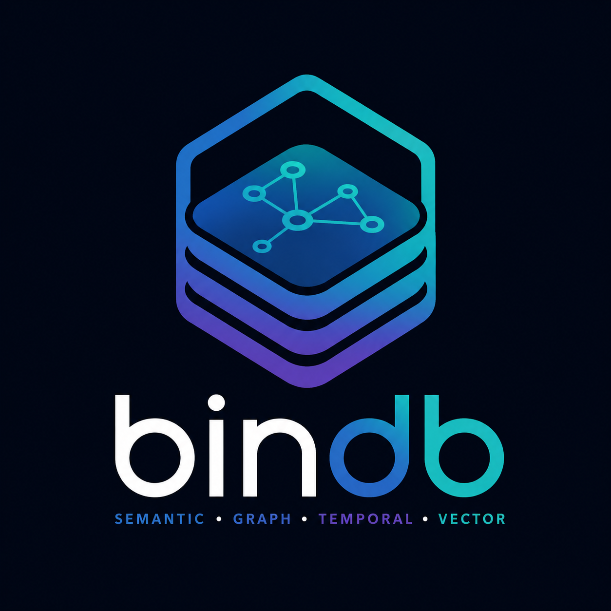
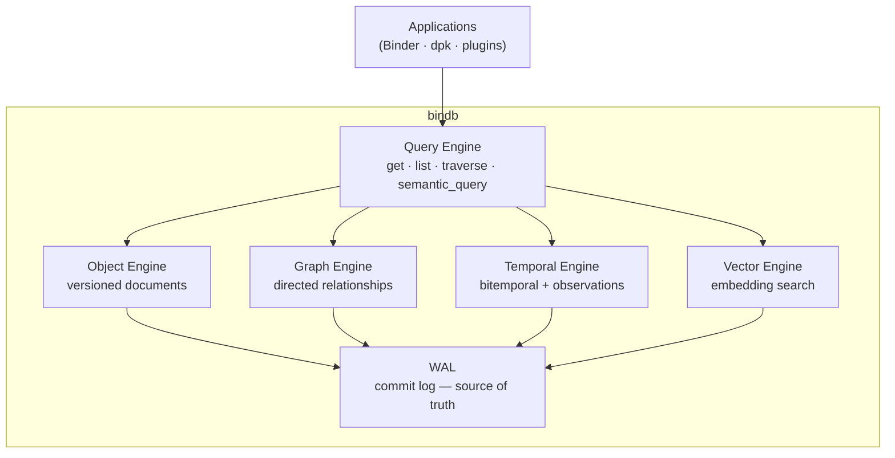
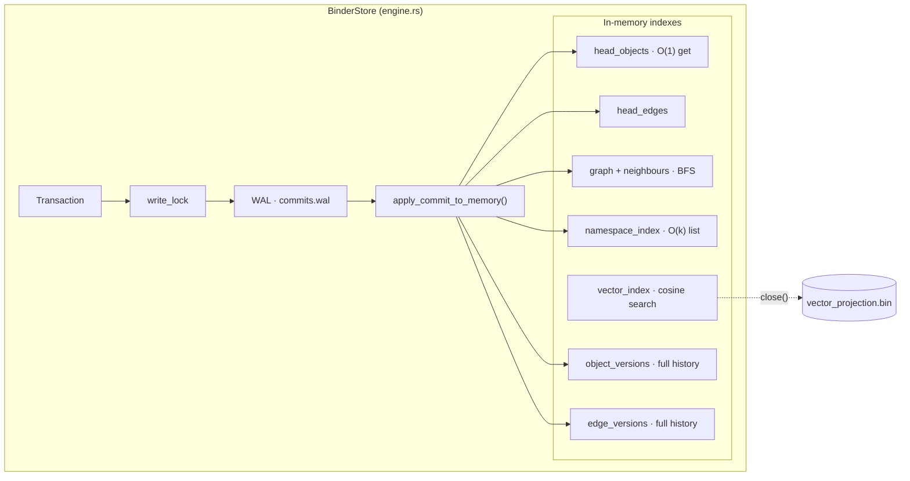

# bindb

<p align="center">
  
</p>

<p align="center">
  <a href="https://github.com/dpkimball/bindb/actions/workflows/ci.yml"></a>
  <a href="https://github.com/dpkimball/bindb/actions/workflows/bench.yml"></a>
</p>

**bindb** is a native embedded database designed for semantic, graph, temporal, and AI-native
applications.

Rather than combining separate databases for each concern — documents, graphs, vectors, analytics —
bindb provides a unified storage engine with first-class support for:

- **Objects** — versioned, typed documents
- **Relationships** — directed graph edges between objects
- **Time** — full version history and point-in-time queries
- **Observations** — metric-typed time series with semantic provenance
- **Vectors** — embedded chunk indexes for semantic search
- **Provenance** — source attribution on every write

All within a single transactional commit log.

---

## Why bindb exists

Traditional semantic application stacks combine multiple databases:

| Database | Role |
|----------|------|
| MongoDB | Document storage |
| Neo4j | Graph relationships |
| Weaviate | Vector / embedding search |
| ClickHouse | Time-series analytics |
| MySQL | Structured records |

Each solves a different problem. Each requires its own schema, client, query language,
operational overhead, and consistency boundary.

bindb replaces that architecture with one storage engine.

---

## High-level architecture



The WAL is the only canonical store. Every engine is a projection of the commit log —
rebuildable, replaceable, never authoritative on their own.

---

## Core concepts

### Object

The fundamental unit of storage.  Every object has a URI-style `ObjectId`:

```
scheme://path
  │         └── entity path within the namespace
  └── namespace owner (e.g. "memory", "obs", "story", "health")
```

Examples: `memory://mem.01J3...`, `obs://health.sleep_duration_h:withings`, `story://st.01J3...`

Objects are versioned.  Every write creates a new immutable version; old versions remain
in the log and are queryable by commit timestamp.

### Edge

A directed relationship between two objects.  Edges are first-class versioned entities —
they can be deleted (tombstoned), updated, and queried historically just like objects.

### Observation

A metric-typed data point attached to an object at a point in time.  Observations are
stored as objects in the `obs://` namespace and associated with a `MetricDefinition` that
declares the unit, type, and schema.

```
MetricDefinition  →  "health.sleep_duration_h" (unit: hours, type: interval)
Observation       →  obs://health.sleep_duration_h:withings  (value, valid_from, valid_to)
```

### Commit

An atomic group of object and edge changes.  Every commit carries:
- A ULID `CommitId` (monotone, time-sortable)
- `actor` — the namespace owner who wrote it
- `timestamp_ms` — wall-clock time at commit
- `parent_commit` — forms the linear commit chain
- Provenance metadata on individual writes

### Version

Every object and edge change produces a `BinderObjectVersion` / `BinderEdgeVersion` with:

- `valid_from` — CommitId when this version became current
- `valid_to` — CommitId when this version was superseded (`None` = still current)
- `payload` — serialized content (`None` = tombstone)

---

## Query surface

Current:

```rust
store.get(&object_id)                         // O(1) HEAD lookup
store.list("obs://")                          // O(k) namespace scan
store.object_as_of(&oid, past_commit)         // bitemporal point-in-time
store.object_history(&oid)                    // full version history
store.traverse(&start, max_depth)             // BFS graph traversal
store.edges_from(&oid)                        // outgoing edges
store.edges_from_with_type(&oid, "RELATES_TO")
store.vector_search(&embedding, &filter, 10)  // cosine similarity
```

Planned:

```
store.query(ObservationQuery)        // metric-filtered observation scan
store.graph_query(GraphQuery)        // pattern-matched subgraph
store.temporal_query(TemporalQuery)  // time-windowed version scan
store.semantic_query(SemanticQuery)  // embedding + namespace + graph combined
```

---

## Write API

```rust
// Single durable commit.
let mut tx = Transaction::new();
tx.put_object(ObjectId::new("memory://mem.abc"), bincode::serialize(&obj)?);
tx.put_edge(EdgeId::new("e1"), from_id, to_id, "RELATES_TO", None);
let commit_id = store.commit(tx, "memory-binder", "created memory")?;

// Bulk ingestion — one fsync for N commits.
for item in large_batch {
    let mut tx = Transaction::new();
    tx.put_object(item.object_id(), item.serialize());
    store.commit_buffered(tx, "importer", "")?;
}
store.flush()?;
```

See [docs/performance.md](docs/performance.md) for throughput characteristics.

---

## Design goals

**Unified** — one store, one consistency boundary, one query surface.  No cross-database
join problem; no partial failure between systems.

**Temporal by default** — every write is versioned.  Time travel and audit trails are
structural, not bolt-on.

**Provenance-aware** — every write can carry a source attribution (`Plugin`, `UserEdit`,
`Import`, `System`).  The full lineage of every data point is recoverable.

**WAL-first durability** — commits are durable before the call returns.  The in-memory
state is always a consistent projection of the commit log.  See [docs/storage.md](docs/storage.md).

**Rebuildable indexes** — every index is a non-canonical projection.  Any index can be
dropped and rebuilt from the commit log without data loss.  See [docs/indexes.md](docs/indexes.md).

**Embeddable** — no daemon, no network layer, no ops overhead.  Open a directory; get a
database.

---

## Implementation architecture

See [docs/storage.md](docs/storage.md) for WAL internals, on-disk layout, and recovery protocol.



---

## Develop

```bash
cargo fmt
cargo clippy --all-targets -- -D warnings
cargo test
cargo bench --bench store_bench
```

---

## Documentation

| Doc | Contents |
|-----|----------|
| [docs/benchmark-comparison.md](docs/benchmark-comparison.md) | Measured performance vs SQLite, DuckDB, MongoDB, Neo4j, ClickHouse, PostgreSQL |
| [docs/comparison.md](docs/comparison.md) | Feature comparison vs SQLite, DuckDB, MongoDB, Neo4j, Weaviate, ClickHouse, PostgreSQL |
| [docs/sla.md](docs/sla.md) | Performance SLAs, scale tiers, CI enforcement |
| [docs/okrs.md](docs/okrs.md) | Engineering OKRs (90-day, evidence via `perf_report`) |
| [docs/roadmap-status.md](docs/roadmap-status.md) | Issue shipped-vs-remaining + interim scale ceiling |
| [docs/storage.md](docs/storage.md) | WAL format, on-disk layout, checkpoint, recovery |
| [docs/indexes.md](docs/indexes.md) | Head indexes, graph, namespace, vector, rebuild rules |
| [docs/performance.md](docs/performance.md) | Throughput, durability modes, scale context |
| [PRINCIPLES.md](PRINCIPLES.md) | The ten implementation invariants |

### Performance report

```bash
PERF_REPORT_DIR=./out cargo run --example perf_report --release
# → out/perf-report.md , out/perf-report.json

# Optional XL (1M objects) — slow, not CI-gated (issue #7):
PERF_REPORT_XL=1 PERF_REPORT_DIR=./out cargo run --example perf_report --release
```

Perf CI (self-hosted, `performance` label on PRs) uploads the same files as artifacts.

---

## Consumers

| Crate | Role |
|-------|------|
| `dpk` | Business Logic Layer — primary consumer; wraps BinderStore behind domain repositories |
| `binder-runtime` | Host runtime — opens the store for the workspace lifetime |
| `dpk-analytics` | Writes observations via `commit_buffered()` bulk path |

Plugins (binder-sdk dependents) must not depend on bindb.  They interact through
registered namespace actors via the host runtime.
