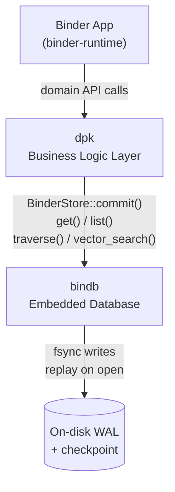
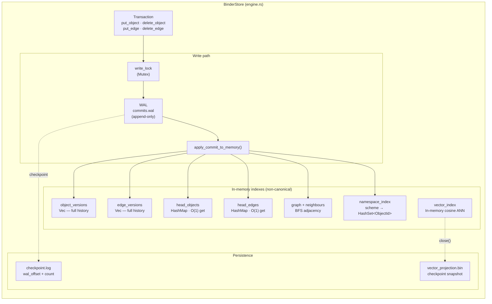
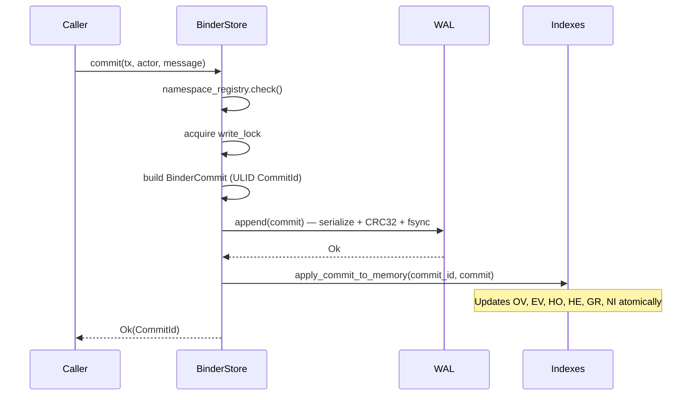
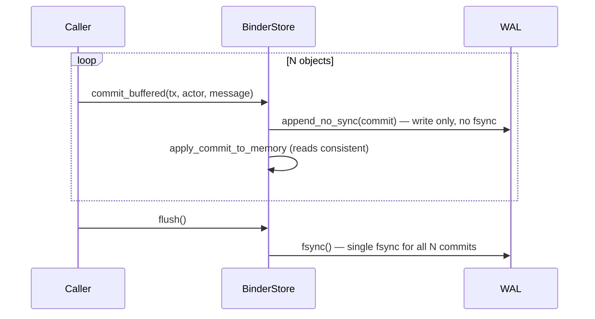
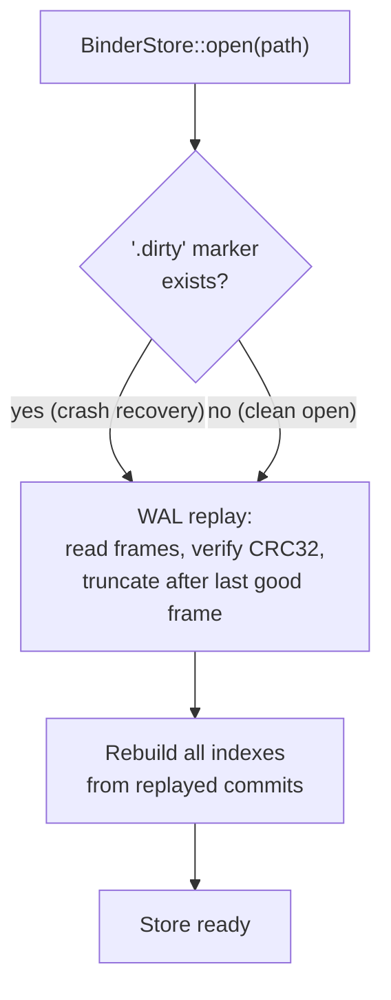
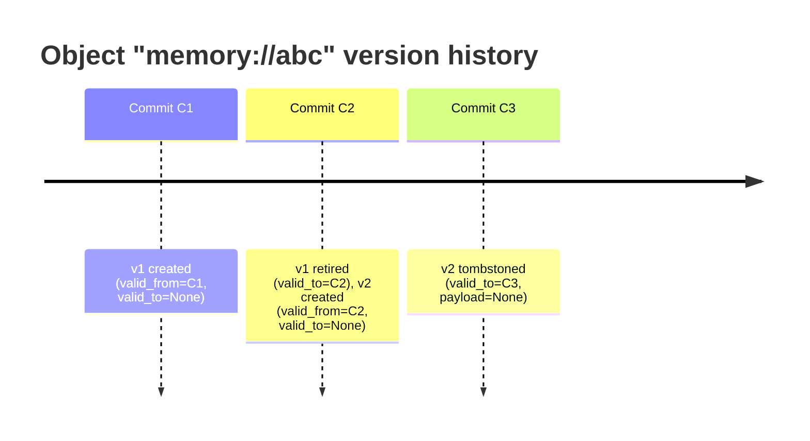

# bindb

**bindb** is the embedded database for the Binder platform — a WAL-first, append-only commit log
for objects, edges, versions, namespaces, graph traversal, and vector search.  It is the single
storage engine for both the desktop app and cloud deployments; MongoDB / Neo4j / Weaviate /
ClickHouse are not required.

Formerly the in-tree `binder-store` crate.  Host-only — plugins must not depend on bindb
(see Binder `boundary-check`).

---

## Architecture

### System context



bindb is a library crate — it has no network layer and no daemon.  It is opened directly from the
process that owns the store directory.

---

### Internal architecture



---

### Write path detail



**Bulk ingestion** skips per-commit fsync:



---

### Recovery path



All indexes are non-canonical projections of the WAL.  If an index were lost, `rebuild_indexes()`
or a fresh `open()` restores them from the commit log.

---

## Data model

### Core types

| Type | Description |
|------|-------------|
| `ObjectId` | `String` — by convention `scheme://path`, e.g. `memory://mem.abc` |
| `EdgeId` | `String` — identifies a directed relationship |
| `CommitId` | ULID — monotonic, time-sortable, globally unique |
| `ObjectVersionId` | ULID — identifies one point-in-time snapshot of an object |

### Object versioning (bitemporal)



Every write creates a new `BinderObjectVersion`.  The previous version's `valid_to` is set to the
current commit.  Deletion creates a tombstone (payload = None).  The WAL only appends — old
versions are never modified on disk.

### Namespace scheme

ObjectIds follow a URI convention so namespaces can be enumerated efficiently:

```
scheme://path
  │         └── arbitrary object path within the namespace
  └── registered namespace owner (e.g. "memory", "obs", "story", "health")
```

Examples:
- `memory://mem.01J3...`
- `obs://health.sleep_duration_h:withings`
- `story://st.01J3...`

`store.list("obs://")` returns all live objects in the `obs` namespace in **O(k)** time via the
secondary `NamespaceObjectIndex`, where k = number of live objects in that namespace.

### Provenance

Every object or edge write may carry optional `Provenance`:

```rust
pub enum ProvenanceSource {
    Plugin(String),   // plugin id
    UserEdit,
    Import(String),   // import job id
    System,
}
```

---

## API reference

### Opening a store

```rust
let store = BinderStore::open(Path::new("/path/to/store"))?;
```

Creates the directory if absent.  Writes a `.dirty` marker immediately; removes it on `close()`.
Safe to open from a single process at a time (file-system directory as lock).

### Writing

```rust
// Single commit — durable after return.
let mut tx = Transaction::new();
tx.put_object(ObjectId::new("memory://mem.abc"), bincode::serialize(&my_obj)?);
tx.put_edge(EdgeId::new("e1"), from_id, to_id, "RELATES_TO", None);
let commit_id = store.commit(tx, "actor", "created memory")?;

// Bulk ingestion — O(1) fsync for N commits.
for obj in large_batch {
    let mut tx = Transaction::new();
    tx.put_object(obj.id(), obj.serialize());
    store.commit_buffered(tx, "importer", "")?;
}
store.flush()?;   // single fsync
```

### Reading

```rust
// O(1) HEAD index lookup.
let version: Option<BinderObjectVersion> = store.get(&object_id)?;

// O(k) namespace scan via secondary index.
let versions: Vec<BinderObjectVersion> = store.list("obs://")?;

// Bitemporal point-in-time.
let past = store.object_as_of(&object_id, past_commit_id)?;

// Full version history.
let history = store.object_history(&object_id)?;

// Graph traversal (BFS).
let reachable: Vec<ObjectId> = store.traverse(&start, max_depth)?;

// Edge queries.
let outgoing: Vec<BinderEdgeVersion> = store.edges_from(&object_id)?;
let typed: Vec<BinderEdgeVersion> = store.edges_from_with_type(&oid, "RELATES_TO")?;

// Vector search (cosine).
let results: Vec<VectorSearchResult> =
    store.vector_search(&embedding, &VectorFilter::default(), 10)?;
```

### Namespace registration

```rust
store.register_namespace("memory", "memory-binder")?;
// Now only "memory-binder" actor may commit to the "memory://" namespace.
```

### Maintenance

```rust
store.rebuild_indexes()?;   // full reindex from version stores
store.close()?;             // fsync + write checkpoint + remove .dirty marker
```

---

## On-disk layout

```text
{store_path}/
├── commits.wal         ← append-only WAL (BNDR magic + entry_id + len + data + CRC32)
├── checkpoint.log      ← 20-byte records: wal_offset + commit_count + CRC32
├── vector_projection.bin ← persisted VectorIndex checkpoint (written on clean close)
└── .dirty              ← marker: present → last close was not clean (crash recovery needed)
```

### WAL frame format

```
┌─────────────────────────────────────────────────────────────────┐
│ 4 bytes  │ MAGIC = "BNDR"                                       │
│ 8 bytes  │ entry_id (u64 LE, monotone)                          │
│ 8 bytes  │ data_len (u64 LE)                                     │
│ N bytes  │ bincode-serialized WalEntryData { commit }            │
│ 4 bytes  │ CRC32 of the N data bytes                             │
└─────────────────────────────────────────────────────────────────┘
```

Replay stops at the first frame with a bad magic, bad CRC, or truncated read.  The file is
truncated to the last good frame offset, so future appends never follow a corrupted entry.

---

## Performance characteristics

| Operation | Complexity | Notes |
|-----------|-----------|-------|
| `commit()` | O(1) write | One WAL append + fsync |
| `commit_buffered()` | O(1) write | One WAL append, no fsync |
| `flush()` | O(1) | Single fsync for all buffered commits |
| `get()` | O(1) | HEAD index HashMap lookup |
| `list(prefix)` | O(k) | k = live objects in namespace |
| `object_history()` | O(n_versions) | Linear scan of version Vec |
| `object_as_of()` | O(n_versions) | Bitemporal scan |
| `edges_from()` | O(degree) | Graph index |
| `traverse()` | O(V+E) within depth | BFS over neighbour map |
| `vector_search()` | O(n_vectors) | In-memory cosine brute-force |
| `rebuild_indexes()` | O(n_commits) | Full replay |

**Durability modes:**

| Mode | Per-commit cost | Durability |
|------|----------------|------------|
| `commit()` | fsync | Durable immediately after return |
| `commit_buffered()` + `flush()` | 1 fsync per batch | Durable after `flush()` |

At ~10K `commit_buffered()` calls followed by one `flush()`, throughput is limited only by memory
write speed rather than disk seek latency.

---

## Invariants

See [`PRINCIPLES.md`](./PRINCIPLES.md).

1. **WAL is canonical** — indexes and projections are derived, never authoritative
2. **Commits are immutable** — once fsynced, a WAL frame is never rewritten
3. **WAL-first writes** — memory state is updated only after a WAL write succeeds
4. **Tombstones, not deletes** — deletion appends a `payload = None` version
5. **Monotone entry ids** — WAL `entry_id` increments; used to detect out-of-order replay
6. **Dirty marker protocol** — `.dirty` is written before any WAL append; removed only on
   clean `close()`; presence at open triggers full replay + truncation

---

## Develop

```bash
cd /path/to/bindb
cargo fmt
cargo clippy --all-targets -- -D warnings
cargo test
cargo bench --bench store_bench
```

---

## Consumers

| Crate | Role |
|-------|------|
| `dpk` / `dpk2` | Business Logic Layer — primary consumer; wraps BinderStore behind domain repositories |
| `binder-runtime` | Host runtime — opens the store for the workspace lifetime |
| `dpk-analytics` | Writes observations via `commit_buffered()` bulk path |

Plugins (binder-sdk dependents) must **not** depend on bindb.  They interact with data only
through their registered namespaces via the host runtime.
