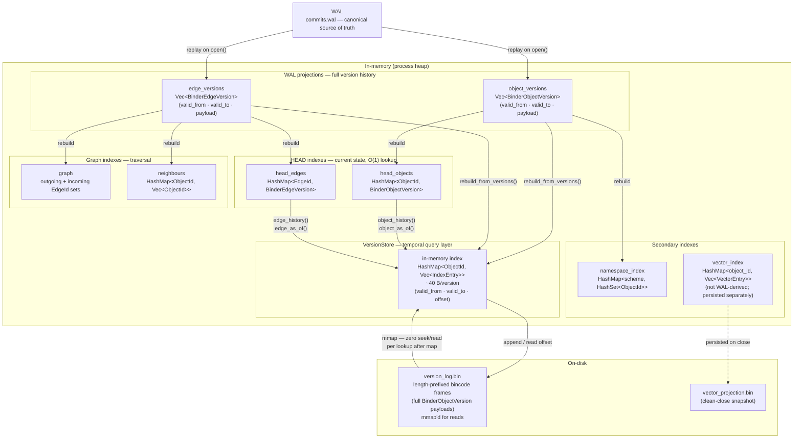

# bindb — Index System

All indexes in bindb are **non-canonical projections** of the WAL commit log.
They can be dropped and rebuilt at any time without data loss (I-7, I-8).
This document describes each index, its structure, and its rebuild contract.

---

## Index map



### Read-path routing

| Query | Route |
|-------|-------|
| `get(id)` | `head_objects` → O(1) HashMap |
| `list(prefix)` | `namespace_index` → O(k_live) |
| `edges_from(id)` | `graph` → O(degree) |
| `traverse(id, depth)` | `neighbours` BFS |
| `object_history(id)` | `VersionStore` → mmap offset lookup |
| `object_as_of(id, at)` | `VersionStore` → binary scan of index entries → mmap |
| `semantic_query(vec)` | `vector_index` cosine scan |
| `sql_aggregate(sql)` | `namespace_index` → `head_objects` filter |

---

## Version stores

### `object_versions: Vec<BinderObjectVersion>`

The complete, immutable history of every object version ever written, in commit order.
Built during WAL replay; updated incrementally on each commit.

Each `BinderObjectVersion` records:

- `object_id` — the object it belongs to
- `valid_from` — CommitId when this version became current
- `valid_to` — CommitId when superseded (`None` = still current)
- `payload` — serialized content (`None` = tombstone)
- `provenance` — optional source attribution

**Role:** source of truth for building HEAD/graph/namespace indexes (`rebuild_indexes()`).
Temporal queries (`object_history`, `object_as_of`) are routed through `VersionStore`,
not this Vec, so reads do not touch the heap for historical version payloads.

### `edge_versions: Vec<BinderEdgeVersion>`

Same structure for edges.

---

## HEAD indexes

### `head_objects: HeadObjectIndex`

```
HashMap<ObjectId, BinderObjectVersion>
```

Maps each ObjectId to its most recent non-tombstone version.  Updated on every commit.
Enables O(1) `get()`.

Rebuilt by scanning `object_versions` in order, keeping the last version per ObjectId
where `valid_to.is_none()`.

### `head_edges: HeadEdgeIndex`

```
HashMap<EdgeId, BinderEdgeVersion>
```

Same structure for edges.

---

## Graph indexes

### `graph: GraphIndex`

Adjacency sets:

```
HashMap<ObjectId, HashSet<EdgeId>>  ← outgoing edges
HashMap<ObjectId, HashSet<EdgeId>>  ← incoming edges
```

Enables `edges_from()`, `edges_to()`, and `edges_from_with_type()` in O(degree) time.

### `neighbours: HashMap<ObjectId, Vec<ObjectId>>`

Flat neighbour list derived from live edges.  Used by `traverse()` for BFS without
re-dereferencing the graph index on every step.

Both graph indexes are rebuilt by iterating `edge_versions` and keeping only
non-tombstone current edges.

---

## Namespace index

### `namespace_index: NamespaceObjectIndex`

```
HashMap<String, HashSet<ObjectId>>
```

The map key is the URI scheme prefix — everything up to and including `"://"`.

```
"memory://"  →  { "memory://mem.abc", "memory://mem.xyz", ... }
"obs://"     →  { "obs://health.sleep_duration_h:withings", ... }
```

Turns `list("memory://")` from O(n_all_versions_ever) into O(k_live_in_namespace).

### Lookup algorithm

1. **Fast path** — exact scheme match.  If the prefix is `"memory://"` and the index has
   that key, return the set directly.
2. **Slow path** — sub-prefix query (e.g. `"memory://mem.0"`).  Extract the scheme
   (`"memory://"`), look up that bucket, filter by `starts_with(prefix)`.
3. **Fallback** — prefix has no `"://"`.  Full scan across all buckets.

The fast path covers the vast majority of production queries.

### Maintenance

- `insert(object_id)` — called in `apply_commit_to_memory()` when a live object is written.
- `remove(object_id)` — called when an object is tombstoned or superseded.
- Empty scheme buckets are removed to keep memory stable.

Rebuilt by iterating `head_objects.all_live()` (the current live HEAD set) rather than
the full version history.

---

## Vector index

### `vector_index: VectorIndex`

```
HashMap<String, Vec<VectorEntry>>
```

Keyed by `object_id`.  Each `VectorEntry` stores:

- `chunk_id` / `chunk_index` — position within a chunked document
- `model_id` — embedding model (e.g. `"text-embedding-3-small"`)
- `dimensions` — vector length
- `vector: Vec<f32>` — the embedding
- `content_hash` — for deduplication
- `source_text` — original text for result display
- Metadata: `binder_id`, `app_id`, `namespace`

Unlike other indexes, the vector index is **not rebuilt from the WAL**.  Embeddings are
recomputed externally and inserted via `store.insert_vector()`.  The index is persisted
on clean `close()` as `vector_projection.bin`.

Search uses brute-force cosine similarity; ANN structures are a future optimization.

---

## VersionStore — temporal query layer

`VersionStore` (`src/version_store.rs`) is a disk-backed component that decouples
temporal query reads from the in-memory `object_versions` / `edge_versions` Vecs.

### In-memory index

```
object_index: HashMap<ObjectId, Vec<IndexEntry>>
    IndexEntry { valid_from: CommitId, valid_to: Option<CommitId>, offset: u64 }
```

Each entry is ~40 bytes — just the temporal bounds and a byte offset into the file.
For a store with 5 M historical versions: ~200 MB (index) vs ~1 GB (full structs).

### On-disk file (`version_log.bin`)

Sequence of length-prefixed bincode frames:

```
[u64 payload_len LE][bincode VersionRecord]
```

`VersionRecord` variants: `Object`, `Edge`, `RetireObject { id, retired_at }`,
`RetireEdge { id, retired_at }`. The file is purely append-only.

### mmap read path

After `rebuild_from_versions()` or `hydrate_index_from_file()`, the full file is
memory-mapped (`memmap2::Mmap`). `read_record_at(offset)` indexes the mmap slice
directly — no seek, no heap allocation per read. Appends invalidate the mapping;
the next read lazily re-maps.

### Lifecycle

| Event | Action |
|-------|--------|
| `open()` after WAL replay | `rebuild_from_versions(&object_versions, &edge_versions)` |
| Each `commit()` / `commit_buffered()` | `retire_object/edge()` then `append_object/edge()` |
| `rebuild_indexes()` | `rebuild_from_versions(&ovs, &evs)` |
| `close()` | `flush()` |

### Rebuild invariant

`version_log.bin` is a non-canonical projection. Truncate it and call
`rebuild_from_versions()` at any time — the WAL is the authoritative source.

---

## Rebuild

`rebuild_indexes()` replays all in-memory version stores and reconstructs every index:

```rust
let new_ho = HeadObjectIndex::rebuild(&ovs);
let new_he = HeadEdgeIndex::rebuild(&evs);
let new_gr = GraphIndex::rebuild(live_edges);
let new_nb = GraphIndex::build_neighbour_map(live_edges);
let new_ni = NamespaceObjectIndex::rebuild(new_ho.all_live());
// also:
version_store.rebuild_from_versions(&ovs, &evs)?;
```

Each index rebuilds from the version stores directly — no index may depend on another
index during its rebuild (I-8).

The vector index is excluded from `rebuild_indexes()` because embeddings are not stored
in the WAL.
