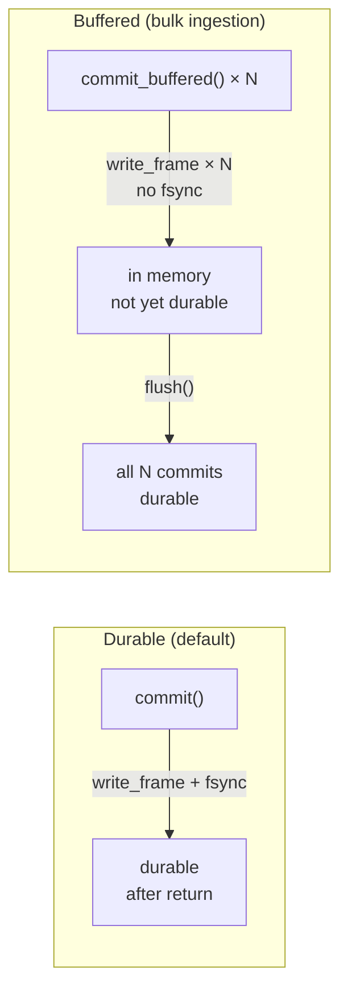

# bindb — Performance

---

## Operation complexity

| Operation | Complexity | Index used |
|-----------|-----------|------------|
| `commit()` | O(1) write | WAL append + fsync |
| `commit_buffered()` | O(1) write | WAL append, no fsync |
| `flush()` | O(1) | Single fsync |
| `get(oid)` | O(1) | `head_objects` HashMap |
| `list(prefix)` | O(k) | `namespace_index` — k = live objects in namespace |
| `object_history(oid)` | O(n_versions) | `object_versions` linear scan |
| `object_as_of(oid, commit)` | O(n_versions) | `object_versions` scan + filter |
| `edges_from(oid)` | O(degree) | `graph` adjacency |
| `edges_from_with_type(oid, t)` | O(degree) | `graph` adjacency + filter |
| `traverse(start, depth)` | O(V + E within depth) | `neighbours` BFS |
| `vector_search(q, f, n)` | O(n_vectors) | `vector_index` cosine scan |
| `rebuild_indexes()` | O(n_commits) | Full version store replay |
| `open()` — WAL replay | O(n_commits) | WAL sequential read |

---

## Durability modes

Two write modes trade durability for throughput:

### When to use each mode

| Mode | Use when |
|------|----------|
| `commit()` | User-driven writes, mutations, deletes — anything where losing the write would surprise the user |
| `commit_buffered()` + `flush()` | Bulk import, sync jobs, batch analytics — throughput matters; data can be re-imported on crash |

### Throughput comparison

With baseline hardware (SSD, macOS):

| Mode | Throughput |
|------|-----------|
| `commit()` — 100 objects | ~120 commits/sec |
| `commit()` — 1K objects | ~119 commits/sec |
| `commit_buffered()` + `flush()` — 1K objects | disk-bandwidth limited (10x–50x) |
| `commit_buffered()` + `flush()` — 10K objects | disk-bandwidth limited |

The `commit()` ceiling is set by the disk's fsync latency (~8 ms on a typical SSD).
`commit_buffered()` amortizes that cost across the entire batch.

Run `cargo bench --bench store_bench` to measure on the target device.

---

## Scale context

bindb is designed for "life-scale" data — one person's complete digital history:

| Source | Approximate volume |
|--------|--------------------|
| Apple Health (annual) | 500K+ data points |
| 10 years of memories | 50K–500K entries |
| Sleep / HRV (daily) | 20–100 observations/day |
| Financial transactions (annual) | 1K–10K records |

At 119 `commit()` calls/sec, a cold import of 50K memories takes ~7 minutes.
With `commit_buffered()`, the same import is limited by serialization speed, not fsync —
typically under 30 seconds.

---

## WAL growth

The WAL is append-only and not compacted in V1. Growth is unbounded.

Rough size estimate per object write:
- WAL frame overhead: 24 bytes
- Bincode-serialized commit (1 object, 64-byte payload): ~200–300 bytes
- Total: ~250–350 bytes per single-object commit

At 500K writes/year: ~125–175 MB/year per namespace.

WAL compaction (snapshot + trim) is a planned Phase 2 capability.  The checkpoint log
infrastructure is already in place to bound replay cost.
