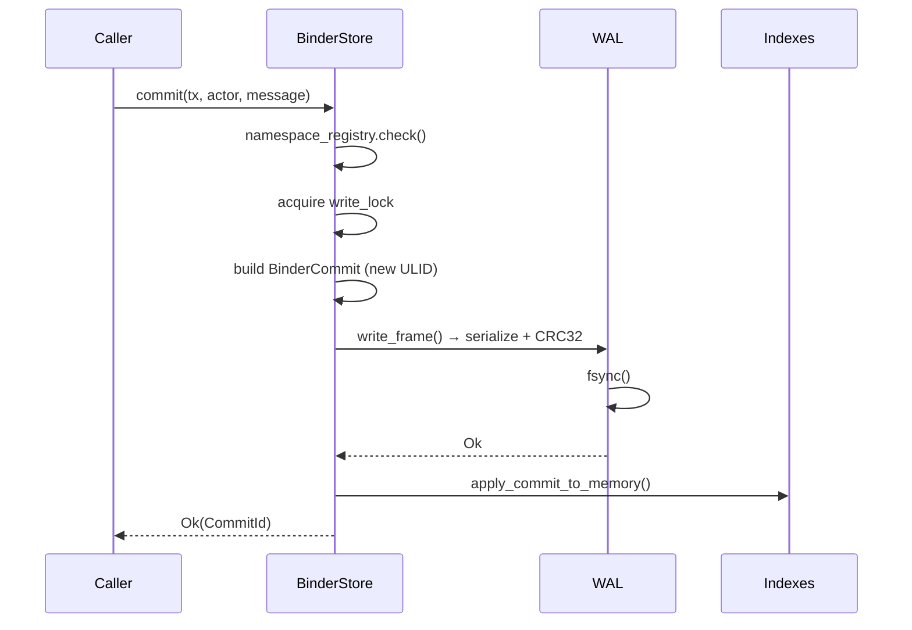
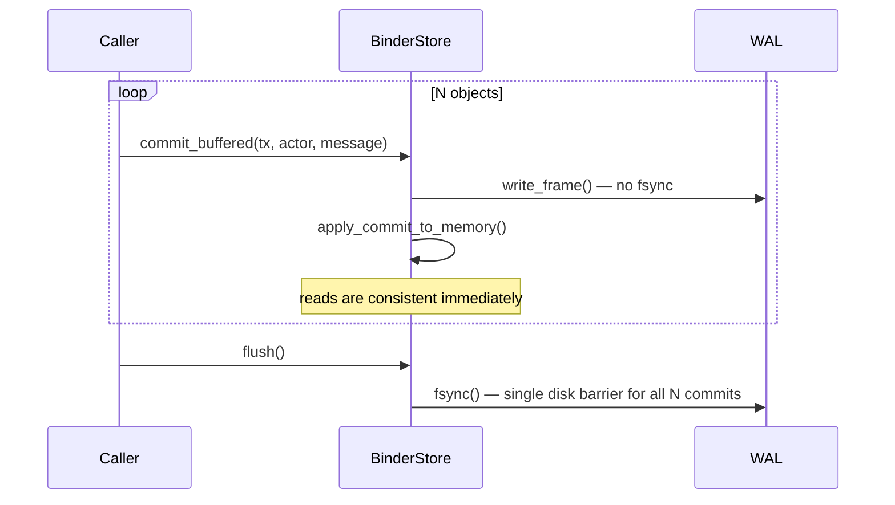
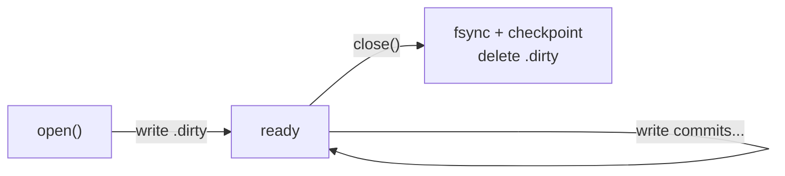
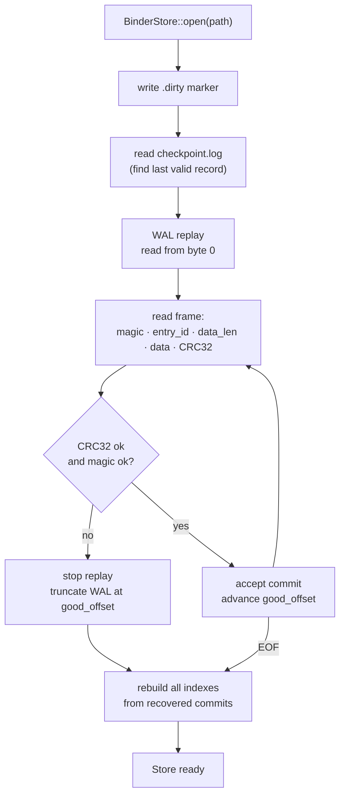

# bindb — Storage Internals

This document covers the WAL, on-disk layout, checkpoint protocol, and crash recovery.
For the high-level architecture see the [README](../README.md).
For implementation invariants see [PRINCIPLES.md](../PRINCIPLES.md).

---

## On-disk layout

```text
{store_path}/
├── commits.wal           ← append-only WAL — the only canonical store
├── checkpoint.log        ← 20-byte records: wal_offset + commit_count + CRC32
├── vector_projection.bin ← persisted VectorIndex snapshot (written on clean close)
└── .dirty                ← crash sentinel; present = last close was unclean
```

The store directory is also used as a process-level lock — only one process may open a
given store path at a time.

---

## WAL frame format

Every commit is serialized as a self-describing frame:

```
┌──────────────────────────────────────────────────────────────┐
│  4 bytes │ magic: b"BNDR"                                    │
│  8 bytes │ entry_id: u64 LE  (monotone counter)             │
│  8 bytes │ data_len: u64 LE                                   │
│  N bytes │ bincode-serialized WalEntryData { commit }         │
│  4 bytes │ CRC32 of the N data bytes only                     │
└──────────────────────────────────────────────────────────────┘
```

Total framing overhead: 24 bytes per commit.

CRC32 covers only the data payload, not the framing header. The magic bytes and entry_id
provide additional corruption detection at the frame boundary.

---

## Write path

### Durable commit (`commit()`)



The in-memory state is **never updated until after `fsync()` succeeds** (I-3).
A crash between `write_frame()` and `fsync()` leaves a partial frame that WAL replay
will detect and discard via CRC mismatch.

### Buffered commit (`commit_buffered()` + `flush()`)



A crash before `flush()` loses all buffered commits. Reads within the process are
consistent because in-memory state is updated immediately.

---

## Dirty marker protocol



On `open()`:

- If `.dirty` is **absent**: the previous close was clean. WAL replay still runs (I-5)
  but may short-circuit via checkpoint.
- If `.dirty` is **present**: the previous process crashed. Full WAL replay is mandatory.

`.dirty` is written before any WAL append and deleted only after a successful `close()`.
A partial WAL write can never produce a `.dirty`-absent dirty state.

---

## Checkpoint log

The checkpoint log is a flat append-only file of 20-byte records:

```
┌──────────────────────────────────────────────┐
│  8 bytes │ wal_offset: u64 LE               │
│  8 bytes │ commit_count: u64 LE             │
│  4 bytes │ CRC32 of the 16 preceding bytes  │
└──────────────────────────────────────────────┘
```

The last valid record (highest offset passing CRC check) is the checkpoint.

In V1 the checkpoint is read at `open()` but WAL replay always starts from the beginning.
The checkpoint infrastructure is in place for Phase 2 when replay-from-checkpoint reduces
startup time on long-lived stores.

---

## Recovery sequence



After recovery:

1. WAL is truncated at the last good frame boundary — future appends never follow a
   corrupt entry.
2. All indexes are rebuilt from the recovered commits.
3. The store is in a consistent state: exactly the commits that were fsynced before the
   crash are present.

---

## Vector projection persistence

The `VectorIndex` is not stored in the WAL (embeddings are large and non-canonical).
On a clean `close()`, the projection is serialized to `vector_projection.bin` so it
does not need to be recomputed on next open.

On open after a crash (`.dirty` present), the stale projection file is discarded and
the caller is expected to re-index from the current objects.
